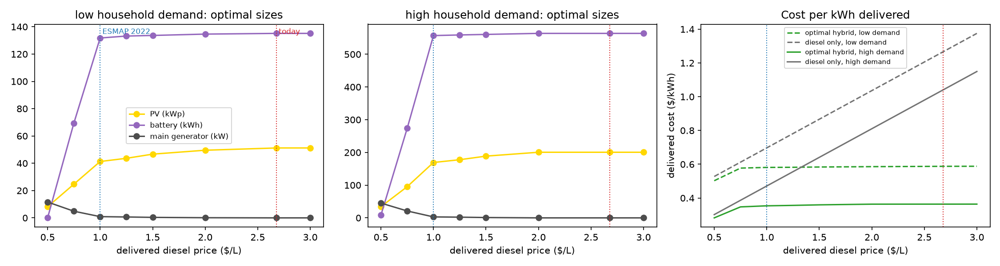
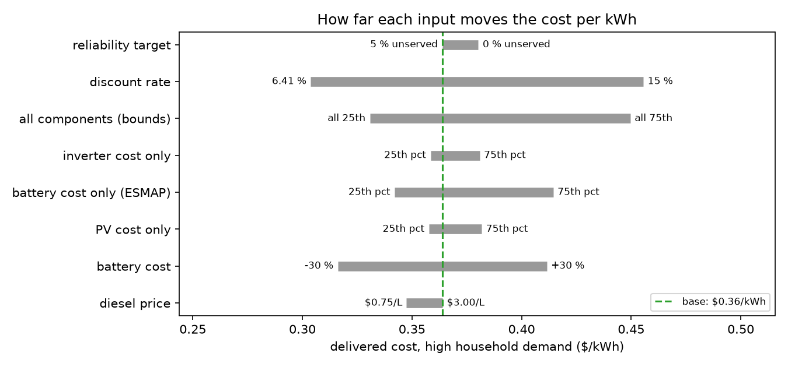

# village-minigrid

**What is the cheapest reliable way to power an off-grid village in Cross River State, Nigeria?**

A solar mini-grid design study for Umon South (Biase LGA, Cross River State): about 312 households plus a primary health centre and a primary school. A model chooses the size of the solar panels, the battery and a diesel generator to keep the clinic and school always on at the lowest cost per kWh.

> A modelling study built on public data, not a site survey. Designs assume one typical weather year.

**Paper (IEEE style, 6 pages):** [report/village_minigrid_paper.pdf](report/village_minigrid_paper.pdf) · **Two-page summary:** [report/village_minigrid.pdf](report/village_minigrid.pdf)

## The short answer

- **Solar plus battery, with no main diesel generator.** Diesel delivered to the village costs about $2.68 a litre (state price plus an assumed 10 % for transport), so generator electricity costs about $0.96 per kWh. The least-cost system delivers at **$0.36 per kWh** (₦500) if households use electricity like grid-connected rural homes, or $0.54-0.59 if they use less. Diesel only would cost $1.04-1.27 per kWh.
- **The clinic and school need protecting.** A model that knows the weather in advance hides 280-288 hours a year when a simple operating rule would cut the clinic and school. A 3-5 kW backup generator for them alone fixes this for 53-89 litres of diesel a year; a battery reserve also works without diesel, but households then lose 6-11 % of their energy instead of about 5 %.
- **The answer holds for any diesel price above about $1.50 a litre.** What moves the cost most is the cost of capital ($0.30-0.46 per kWh for a 6.4-15 % discount rate), then battery prices and demand growth.

## How it works

1. **Site.** One village cluster (number 10645) from a published rural electrification dataset: its customer count and its clinic and school.
2. **Sunshine.** An hour-by-hour typical year of sunshine and temperature from PVGIS, turned into solar output per kWp of panels.
3. **Demand.** An hour-by-hour year of demand built from a World Bank household survey (which appliances people own and how long they use them), plus published load lists for a Nigerian clinic and school. Two cases: low and high household use.
4. **Costs.** Published equipment prices, the state diesel price plus transport, and lifetimes. Every cost has a source in [`docs/cost_table.md`](docs/cost_table.md).
5. **Optimise.** PyPSA (with the free HiGHS solver) picks the sizes and the hour-by-hour operation that give the lowest yearly cost, with the clinic and school on in every hour and households short of at most 5 % of their energy.
6. **Check without foresight.** The chosen system is run again hour by hour with a simple operating rule that does not know tomorrow's weather (clinic and school served first). The final design and its cost come from this run.
7. **Stress-test.** Diesel price, equipment costs, discount rate, the reliability target and demand growth are moved one at a time.

## Results

### Notebook 01: site and demand

- Solar: about 1,450 kWh per kWp a year, dipping to about 3.1 kWh/kWp/day in July (rainy season).
- Demand, two cases: **low** about 136 kWh/day (households like the average rural survey household, most not yet electrified) and **high** about 568 kWh/day (households like rural households already on the grid). The evening peak is at 21:00-22:00, after sunset.

### Notebook 02: the least-cost mix

Sizes the system for 3 designs x 2 household-demand cases x 2 clinic cases. Every run passes hand checks: supply equals demand every hour, the battery stays in its limits, and the cost recomputed outside PyPSA matches the solver.


- **At today's diesel price the least-cost design is solar plus battery.** The optimiser builds essentially no main generator (at most 0.04 kW). Diesel only would cost $1.04-1.27 per kWh.
- **The optimiser cheats a little: it knows the weather in advance.** It keeps the clinic and school on by rationing households before cloudy spells. Run hour by hour with a simple rule and no foresight, the same system would cut the clinic and school for 280-288 hours a year.
- **Two fixes, a trade-off.** A 3-5 kW backup generator for the clinic and school only keeps them on in every hour for 53-89 litres of diesel and about $210-355 a year. A battery reserve of 22-29 % kept for them needs no diesel, but households then lose 6-11 % of their energy. The backup gives a slightly lower cost per kWh because households get more energy.
- **Households still face long outages.** Without foresight the longest household outage is 13 hours, and 78-79 % of the shortfall falls between May and October.
- **Up to a third of the solar output is spilled** (29-33 %). The panels are sized for the rainy season, so the dry season has spare daytime power that a mill or cold store could use (not modelled).

| Final design | Low household demand | High household demand |
|---|---|---|
| Solar PV | 51-59 kWp | 201-208 kWp |
| Battery (Li-ion) | 135-143 kWh | 564-571 kWh |
| Battery inverter | 17-18 kW | 70-71 kW |
| Backup generator (clinic and school only) | 3-5 kW | 3-5 kW |
| Households' energy not served | 4.5-4.6 % | 4.9 % |
| Longest household outage | 13 h | 13 h |
| Delivered cost per kWh | $0.54-0.59 (₦757-818) | $0.36 (₦500-506) |

The ranges cover the two clinic cases.


RLI's own design for this cluster (96 kWp, 168 kWh, 77 kW generator, 65.6 % renewable share; units not stated) was made under demand and cost assumptions that are not published, so the two designs cannot be compared directly.

### Notebook 03: how far the answer holds

Moves one uncertain input at a time (56 optimisations, each re-run without foresight).



- **The solar design is insulated from the diesel price; diesel only is not.** From $2 a litre the optimum has no main generator to speak of and costs about $0.36 per kWh (high demand) whatever diesel costs. Diesel only rises from about $0.30 to $1.15 per kWh over the same range.
- **A main generator only pays with cheap diesel.** At $0.50 a litre the optimum is diesel-led; at $0.75 it is still 5-21 kW; at ESMAP's 2022 assumption of $1 it is only 1-3 kW. Where a small generator is built, households end up 5-10 % short under the simple rule.
- **The cost of capital matters most.** A real discount rate of 6.4 % gives $0.30 per kWh and 15 % gives $0.46 (high demand), against $0.36 at 10 %.
- **Of the equipment costs, the battery matters most.** ESMAP's 25th to 75th percentile battery cost gives $0.34-0.41 per kWh; PV or inverter alone move it by about 2 cents; all three together give $0.33-0.45. The sizes hardly change.

  

- **Full reliability is cheap, on paper.** Designing for 0 % household shortfall instead of 5 % adds 0.8-1.6 US cents per kWh, but without foresight even that design leaves households 2.2-2.4 % short.
- **Size for growth.** Built for today and run with 5 years of 5 % yearly growth, the system leaves households about a fifth of their energy short. Sized for year 5 (about 254 kWp and 717 kWh, high demand) it costs about the same per kWh over 20 years and keeps the shortfall near 5 %.

## What this study does not do

- **One typical weather year.** A run of bad rainy seasons is not tested.
- **No site survey.** Demand comes from North-West survey households, not from people in Umon South, and nobody was asked what they would pay. Appliance use is the same every day, which may understate the battery needed.
- **Global costs.** Equipment prices are ESMAP's averages and medians across many countries, not Nigerian quotes; the balance-of-system cost is read from a chart. Import duties, financing and subsidies are left out.
- **No network model.** The village's low-voltage network is a cost per customer only: no losses, voltage limits or cable layout.
- **No tariff study.** Whether households can afford ₦500 or more per kWh is not studied.
- **Leans towards diesel.** The generator has no minimum load or idle fuel use, and battery prices are from 2021, so the case for solar is if anything understated.

Assumptions of my own, not from a published source:
- Cross River households use electricity like the North-West households in the survey.
- Nameplate wattages for irons (1,000 W), kettles (1,500 W), incandescent bulbs (60 W), CFLs (15 W) and fluorescent tubes (36 W).
- Usage windows for each appliance (in `src/demand.py`).
- The school calendar (closed in August and two weeks each at Christmas and Easter).
- A 10 % surcharge on the state diesel price for delivery to the village.
- A 10-year life for the battery inverter.
- ESMAP's 2021 balance-of-system cost ($340 per kWp of solar) read from its Figure 1.10, whose legend labels are swapped; the line was identified from the caption and text.
- Household demand growth of 5 % a year for five years, then flat (growth sweep only).

## Run it yourself

Python 3.11.

```bash
python3.11 -m venv .venv
source .venv/bin/activate
pip install -r requirements.txt
jupyter lab
```

Run the notebooks in `notebooks/` in order (01, 02, 03). The first run downloads the public data into `data/` (not stored in this repo); each notebook saves its results to `data/processed/` and rebuilds anything missing, so they also run on their own.

| Folder | What is in it |
|---|---|
| `src/data_sources.py` | Downloads and caches the site, survey and solar data |
| `src/solar.py` | Hourly solar output per kWp |
| `src/demand.py` | Appliance lists and the hourly demand model (RAMP) |
| `src/costs.py` | Every cost and its source |
| `src/model.py` | The PyPSA model, hand checks and the no-foresight run |
| `src/sensitivity.py` | The one-at-a-time sweeps |
| `notebooks/` | 01 site and demand, 02 least-cost mix, 03 sensitivity |
| `figures/`, `report/` | Figures, the paper (`paper_src.html` + `build_paper.py`) and the two-page summary |

## Data sources

| Data | Source | Licence |
|---|---|---|
| Village cluster (customers, population, facilities, grid distance) | Reiner Lemoine Institut / GIZ Nigerian Energy Support Programme, *Rural Electrification Modelling for five Nigerian Federal States*, on [energydata.info](https://energydata.info/dataset/rural-electrification-modelling-for-five-nigerian-federal-states) | CC BY-SA 4.0 |
| Household energy use | World Bank ESMAP, *Multi-Tier Framework survey, Nigeria 2018*, on [energydata.info](https://energydata.info/en/dataset/nigeria-multi-tier-framework-mtf-survey-59) | CC BY 4.0 |
| Health centre load (high case) | SEforALL, [*Nigeria roadmap: powering healthcare*](https://www.seforall.org/system/files/2022-03/nigeria-roadmap-powering-healthcare-March-22.pdf): Type 2 PHC, about 36 kWh/day | cited |
| School and clinic appliance lists, most wattages | Lighting Global, [*PV System Design Tool and Example Designs*](https://www.lightingglobal.org/wp-content/uploads/2023/03/PV-System-Design-Tool-and-Example-Designs.pdf) (Nigerian school and clinic designs, FCT) | cited |
| Radio, freezer, blender wattages; demand tool | [RAMP](https://github.com/RAMP-project/RAMP) (Lombardi et al. 2019) example inputs and model | EUPL-1.2 |
| Equipment costs, battery performance, upkeep, staff | World Bank ESMAP, [*Mini Grids for Half a Billion People*](https://openknowledge.worldbank.org/entities/publication/b53273b6-b19a-578e-8949-8dc5c7a3cd79) (2022) | CC BY 3.0 IGO |
| Diesel generator price and lifetimes | Esan et al., [*Heliyon* 5(5) e01632](https://pmc.ncbi.nlm.nih.gov/articles/PMC6517602/) (2019) | CC BY |
| Generator fuel curve | HOMER Pro manual, generator fuel curve example | cited |
| Diesel price | National Bureau of Statistics, Diesel Price Watch, Cross River, May 2026 | cited |
| Exchange rate | Central Bank of Nigeria central rate, 25 Nov 2026 (₦1,391.75 per US$) | cited |
| Solar | EU JRC [PVGIS 5.3](https://re.jrc.ec.europa.eu/pvg_tools/en/) typical year (SARAH3, 2005-2023) | free to use, cited |
