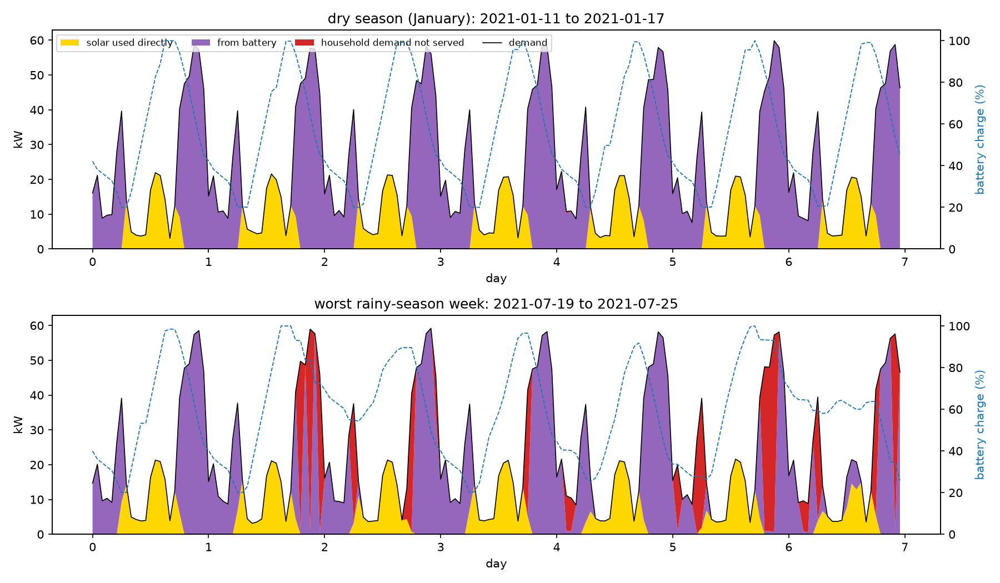

# village-minigrid

**What is the cheapest reliable way to power an off-grid village in Cross River State, Nigeria?**

A solar mini-grid design study for Umon South (Biase LGA, Cross River State): about 312 households plus a primary health centre and a primary school. A model chooses the size of the solar panels, the battery and a diesel generator to keep the clinic and school always on at the lowest cost per kWh.

> A modelling study built on public data, not a site survey. Designs assume one typical weather year.

**Paper (IEEE style, 6 pages):** [report/village_minigrid_paper.pdf](report/village_minigrid_paper.pdf) · **Two-page summary:** [report/village_minigrid.pdf](report/village_minigrid.pdf)

## The short answer

- **Solar plus battery, with no main diesel generator.** Diesel delivered to the village costs about $2.68 a litre, so generator electricity costs about $0.94 per kWh. The least-cost system delivers at **$0.34 per kWh** (₦470) if households use electricity like grid-connected rural homes, or $0.52-0.57 if they use less. Diesel only would cost $1.03-1.26 per kWh.
- **A small backup generator for the clinic and school.** A model that knows the weather in advance hides about 330 hours a year when the clinic and school would lose power. A 3-5 kW generator that serves only them fixes this for 60-100 litres of diesel a year.
- **The answer holds for any diesel price above about $1.50 a litre.** What moves the cost most is equipment prices ($0.31-0.43 per kWh across ESMAP's range) and how fast demand grows.

## How it works

1. **Site.** One village cluster (number 10645) from a published rural electrification dataset: its customer count and its clinic and school.
2. **Sunshine.** An hour-by-hour typical year of sunshine and temperature from PVGIS, turned into solar output per kWp of panels.
3. **Demand.** An hour-by-hour year of demand built from a World Bank household survey (which appliances people own and how long they use them), plus published load lists for a Nigerian clinic and school. Two cases: low and high household use.
4. **Costs.** Published equipment prices, the state diesel price plus transport, and lifetimes. Every cost has a source in [`docs/cost_table.md`](docs/cost_table.md).
5. **Optimise.** PyPSA (with the free HiGHS solver) picks the sizes and the hour-by-hour operation that give the lowest yearly cost, with the clinic and school on in every hour and households short of at most 5 % of their energy.
6. **Check without foresight.** The chosen system is run again hour by hour with a simple operating rule that does not know tomorrow's weather. The final design and its cost come from this run.
7. **Stress-test.** Diesel price, equipment costs, the reliability target and demand growth are moved one at a time.

## Results

### Notebook 01: site and demand

- Solar: about 1,450 kWh per kWp a year, dipping to about 3.1 kWh/kWp/day in July (rainy season).
- Demand, two cases: **low** about 136 kWh/day (households like the average rural survey household, most not yet electrified) and **high** about 568 kWh/day (households like rural households already on the grid). The evening peak is at 21:00-22:00, after sunset.

### Notebook 02: the least-cost mix

Sizes the system for 3 designs x 2 household-demand cases x 2 clinic cases. Every run passes hand checks: supply equals demand every hour, the battery stays in its limits, and the cost recomputed outside PyPSA matches the solver.


- **At today's diesel price (about $2.68 a litre delivered) the least-cost design is solar plus battery.** The optimiser builds no main generator in any case. Diesel only would cost $1.03-1.26 per kWh.
- **The optimiser cheats a little: it knows the weather in advance.** It keeps the clinic and school on by rationing households before cloudy spells. Run hour by hour with a simple rule and no foresight, the same system would cut the clinic and school for about 330 hours a year.
- **Fix: a 3-5 kW backup generator for the clinic and school only.** It keeps them on in every hour, burns 60-100 litres of diesel a year and adds about $220-380 a year.
- **About a third of the solar output is spilled.** The panels are sized for the rainy season, so the dry season has spare daytime power that a mill or cold store could use (not modelled).

| Final design | Low household demand | High household demand |
|---|---|---|
| Solar PV | 54-62 kWp | 209-217 kWp |
| Battery (Li-ion) | 133-141 kWh | 558-565 kWh |
| Battery inverter | 16-17 kW | 65-67 kW |
| Backup generator (clinic and school only) | 3-5 kW | 3-5 kW |
| Households' energy not served | 4.3-4.6 % | 4.8-4.9 % |
| Delivered cost per kWh | $0.52-0.57 (₦723-786) | $0.34 (₦468-475) |

The ranges cover the two clinic cases.



RLI's own design for this cluster (96 kWp, 168 kWh, 77 kW generator; units not stated) was made under different, unstated assumptions, most likely much cheaper diesel.

### Notebook 03: how far the answer holds

Moves one uncertain input at a time (38 optimisations, each re-run without foresight).


- **The solar design is insulated from the diesel price; diesel only is not.** Above about $1.50 a litre the optimum has no main generator and costs about $0.34 per kWh (high demand) whatever diesel costs. Diesel only rises from about $0.32 to $1.14 per kWh over the same range.
- **A main generator only pays with cheap diesel.** At $0.50 a litre the optimum is diesel-led; at ESMAP's 2022 assumption of $1 it is already under 1 kW. RLI's 77 kW generator therefore implies diesel well under $1 a litre, or other assumptions.
- **Equipment cost is the biggest remaining uncertainty.** ESMAP's 25th to 75th percentile costs give $0.31-0.43 per kWh (high demand). The sizes hardly change; the price does. Battery cost alone, ±30 %, gives $0.29-0.39.

  

- **Full reliability is cheap.** Designing for 0 % household shortfall instead of 5 % adds only about 2 US cents per kWh, but without foresight even that design leaves households about 1.5-2.5 % short.
- **Size for growth.** Built for today and run with 5 years of 5 % yearly growth, the system leaves households about a fifth of their energy short. Sized for year 5 (about 264 kWp and 710 kWh, high demand) it costs about the same per kWh.

## What this study does not do

- **One typical weather year.** A run of bad rainy seasons is not tested.
- **No site survey.** Demand comes from North-West survey households, not from people in Umon South, and nobody was asked what they would pay.
- **Global costs.** Equipment prices are ESMAP's medians across many countries, not Nigerian quotes. Import duties, financing, subsidies and salvage value are left out.
- **No network model.** The village's low-voltage network is a cost per customer only: no losses, voltage limits or cable layout.
- **No tariff study.** Whether households can afford ₦470 or more per kWh is not studied.

Assumptions of my own, not from a published source:
- Cross River households use electricity like the North-West households in the survey.
- Nameplate wattages for irons (1,000 W), kettles (1,500 W), incandescent bulbs (60 W), CFLs (15 W) and fluorescent tubes (36 W).
- Usage windows for each appliance (in `src/demand.py`).
- The school calendar (closed in August and two weeks each at Christmas and Easter).
- A 10 % surcharge on the state diesel price for delivery to the village.
- A 10-year life for the battery inverter.
- ESMAP's balance-of-system cost ($524/kW) applied per kW of peak demand (ESMAP does not state the unit basis).

## Run it yourself

Python 3.11.

```bash
python3.11 -m venv .venv
source .venv/bin/activate
pip install -r requirements.txt
jupyter lab
```

Run the notebooks in `notebooks/` in order (01, 02, 03). The first run downloads the public data into `data/` (not stored in this repo); each notebook saves its results to `data/processed/` and rebuilds anything missing, so they also run on their own.

| Folder | What is in it |
|---|---|
| `src/data_sources.py` | Downloads and caches the site, survey and solar data |
| `src/solar.py` | Hourly solar output per kWp |
| `src/demand.py` | Appliance lists and the hourly demand model (RAMP) |
| `src/costs.py` | Every cost and its source |
| `src/model.py` | The PyPSA model, hand checks and the no-foresight run |
| `src/sensitivity.py` | The one-at-a-time sweeps |
| `notebooks/` | 01 site and demand, 02 least-cost mix, 03 sensitivity |
| `figures/`, `report/` | Figures, the paper (`paper_src.html` + `build_paper.py`) and the two-page summary |

## Data sources

| Data | Source | Licence |
|---|---|---|
| Village cluster (customers, population, facilities, grid distance) | Reiner Lemoine Institut / GIZ Nigerian Energy Support Programme, *Rural Electrification Modelling for five Nigerian Federal States*, on [energydata.info](https://energydata.info/dataset/rural-electrification-modelling-for-five-nigerian-federal-states) | CC BY-SA 4.0 |
| Household energy use | World Bank ESMAP, *Multi-Tier Framework survey, Nigeria 2018*, on [energydata.info](https://energydata.info/en/dataset/nigeria-multi-tier-framework-mtf-survey-59) | CC BY 4.0 |
| Health centre load (high case) | SEforALL, [*Nigeria roadmap: powering healthcare*](https://www.seforall.org/system/files/2022-03/nigeria-roadmap-powering-healthcare-March-22.pdf): Type 2 PHC, about 36 kWh/day | cited |
| School and clinic appliance lists, most wattages | Lighting Global, [*PV System Design Tool and Example Designs*](https://www.lightingglobal.org/wp-content/uploads/2023/03/PV-System-Design-Tool-and-Example-Designs.pdf) (Nigerian school and clinic designs, FCT) | cited |
| Radio, freezer, blender wattages; demand tool | [RAMP](https://github.com/RAMP-project/RAMP) (Lombardi et al. 2019) example inputs and model | EUPL-1.2 |
| Equipment costs, battery performance, upkeep, staff | World Bank ESMAP, [*Mini Grids for Half a Billion People*](https://openknowledge.worldbank.org/entities/publication/b53273b6-b19a-578e-8949-8dc5c7a3cd79) (2022) | CC BY 3.0 IGO |
| Diesel generator price and lifetimes | Esan et al., [*Heliyon* 5(5) e01632](https://pmc.ncbi.nlm.nih.gov/articles/PMC6517602/) (2019) | CC BY |
| Generator fuel curve | HOMER Pro manual, generator fuel curve example | cited |
| Diesel price | National Bureau of Statistics, Diesel Price Watch, Cross River, May 2026 | cited |
| Exchange rate | Central Bank of Nigeria central rate, 25 Nov 2026 (₦1,391.75 per US$) | cited |
| Solar | EU JRC [PVGIS 5.3](https://re.jrc.ec.europa.eu/pvg_tools/en/) typical year (SARAH3, 2005-2023) | free to use, cited |
